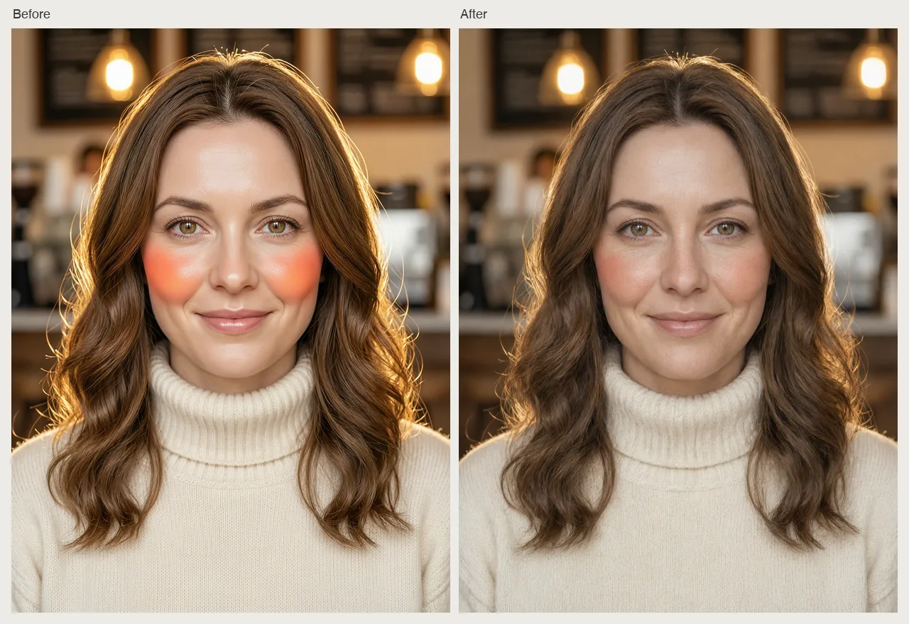
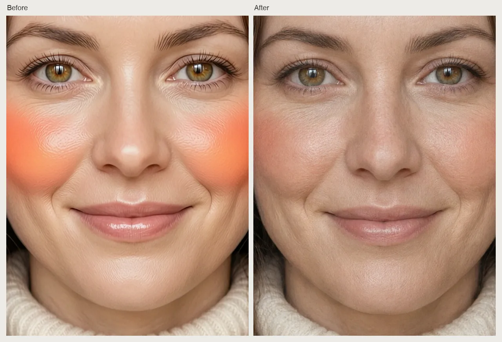

# AI Image Realism Skill

English | [简体中文](./README.zh-CN.md)

Make existing AI portraits, product images, and marketing visuals look more natural by fixing plastic skin, malformed hands and faces, repeated textures, and inconsistent lighting, from inside Claude Code, Codex, or OpenClaw.

> [!IMPORTANT]
> Rendering needs a [Beatra](https://beatra.ai) account and uses credits. The skill itself is free to install.

| Question | Answer |
| --- | --- |
| **What it does** | Make existing AI portraits, product images, and marketing visuals look more natural by fixing plastic skin, malformed hands and faces, repeated textures, and inconsistent lighting. |
| **Requirements** | Python 3.10+ and an agent that loads `SKILL.md` |
| **Cost** | Free to install. Each render uses credits on your Beatra account, and paid steps run only when you ask for that exact render or approve its card. |
| **Works with** | Claude Code, Codex, OpenClaw |

<p align="center"></p>

*A portrait of a fictional woman deliberately generated with the waxy, over-saturated AI look for this demo, then repaired to natural skin texture and warmer realistic light while keeping her face, pose, sweater, and cafe background. AI-generated with Beatra.*

| Skill | Entry point | Version |
| --- | --- | --- |
| [`ai-image-realism`](skills/ai-image-realism) | [SKILL.md](skills/ai-image-realism/SKILL.md) | 0.3.4 |

This repository is published automatically from [beatra-ai/beatra-skills](https://github.com/beatra-ai/beatra-skills/tree/main/skills/ai-image-realism). Report issues there.

## Install

With the [`skills`](https://skills.sh) CLI:

```bash
npx skills add beatra-ai/ai-image-realism-skill
```

With the GitHub CLI:

```bash
gh skill install beatra-ai/ai-image-realism-skill ai-image-realism
```

Or clone this repository and copy `skills/ai-image-realism` into `~/.claude/skills/` for Claude Code,
`~/.agents/skills/` for Codex, or `~/.openclaw/skills/` for OpenClaw.

Or paste this into your agent:

```text
Install the ai-image-realism skill from https://github.com/beatra-ai/ai-image-realism-skill (folder skills/ai-image-realism), then follow its SKILL.md to connect my Beatra account.
```

## Examples

<p align="center"></p>

*Close-up of the same face before and after the repair, showing airbrushed skin and round orange blush patches replaced by visible pores and a natural flush. AI-generated with Beatra.*

Prompt:

```text
[before] Close-up head-and-shoulders portrait of a fictional woman in her early thirties with shoulder-length wavy chestnut hair, hazel eyes and a soft closed-mouth smile, wearing a cream knit turtleneck sweater, standing in front of a softly blurred indoor cafe background with warm bokeh lights. Render it in the stereotypical glossy AI-generated portrait look: waxy, airbrushed, plastic-smooth skin with no pores, over-saturated orange-pink glow on the cheeks, a dreamy bloom haze, overly bright rim light, unnaturally perfect mirror-symmetric facial features and glassy doll-like eyes. Front-facing, centered, looking into the camera, both eyes clearly visible, hands out of frame, no text, no logos. ||| [after] Reduce the plastic, airbrushed AI look across this portrait so it reads like a real camera photograph. Restore natural skin texture with fine visible pores, subtle fine lines and slight natural unevenness in skin tone; replace the two round orange blush patches with a faint natural flush; tone down the over-saturated orange-pink glow, bloom haze and over-bright rim light to realistic warm cafe lighting with natural color; make the catchlights in the eyes small and natural. Preserve the same woman's identity and facial features, expression and closed-mouth smile, eye color, wavy chestnut hairstyle, cream knit turtleneck sweater, pose, framing, crop, cafe background and lighting direction. Do not add makeup, text or logos.
```

## Technical Specifications & Output Limits

As of 2026-10-16. Live list: https://docs.beatra.ai/en/docs/models

- **Uploads** — up to 100 MB per file; the per-model input limits below also apply
- **Image editing** — 6 models (Qwen Image 2.0 Fast, Qwen Image 3.0, Qwen Image 3.0 Pro, Wan Image 2.7 Fast, Qwen Image 2.0 Pro, Wan Image 2.7 Pro); PNG; up to 4 images per request; canvas up to 4.2 MP
  - 4.2 MP (2K tier): Qwen Image 2.0 Fast, Qwen Image 3.0, Qwen Image 3.0 Pro, Wan Image 2.7 Fast, Qwen Image 2.0 Pro, Wan Image 2.7 Pro (up to 4 images per request)
  - Input images: up to 4 per request, 10–20 MB each; BMP, GIF, JPEG, PNG, TIFF, WEBP
- **Image to image** — 10 models (Qwen Image 2.0 Fast, Qwen Image 3.0, Qwen Image 3.0 Pro, Wan Image 2.7 Fast, Qwen Image 2.0 Pro, Wan Image 2.7 Pro, GPT Image 2.5 Flare, GPT Image 2.5 Sunburst, GPT Image 2, MiniMax Image 01 Live); PNG; up to 4 images per request; canvas up to 16.8 MP
  - 16.8 MP (4K tier): GPT Image 2.5 Flare, GPT Image 2.5 Sunburst, GPT Image 2 (1 image per request)
  - Input images: up to 4 per request, 10–20 MB each; BMP, GIF, JPEG, PNG, TIFF, WEBP

## Why use Beatra instead of calling model APIs directly

- **One account for every model this skill uses** — Image editing 6; Image to image 10 (as of 2026-10-16), behind one Beatra sign-in; no keys from individual model providers to manage.
- **You decide what gets paid for** — Paid renders run only when you ask for that exact render or approve its card, which shows the live credit estimate.
- **Direction before rendering** — the skill plans, directs, and reviews the work, then renders it on Beatra.
- **Files you can verify** — every file under `skills/` matches the release archive on cdn.beatra.ai byte for byte, checked by SHA-256 before each push.
- **Updates you control** — no self-updater; update with the tool you installed it with.
- **Runs in your agent** — Claude Code, Codex, OpenClaw.

## What you get

- **Diagnose before changing** — Review anatomy, texture, lighting, background, composition, text, and destination fit, then focus on the one problem cluster that matters most.
- **Repair the smallest useful area** — Choose a targeted local repair or a whole-image texture pass instead of replacing a nearly accepted image.
- **Protect what already works** — Keep identity, product shape, brand details, composition, and unaffected areas recognizable where possible.

## Use cases

- **Naturalize AI portraits** — Reduce plastic-looking skin, repair hands and facial details, and keep the person's accepted appearance recognizable where possible.
- **Refine product and e-commerce images** — Correct reflections, material texture, shadows, and background repetition while keeping product shape, color, packaging, and brand marks recognizable where possible.
- **Polish marketing and ad visuals** — Fix distracting artifacts and inconsistent light while keeping the selected message, layout, and key visual recognizable where possible.
- **Clean up social covers** — Make feed and cover images feel less templated while keeping the crop, safe areas, subject, and text layout recognizable where possible.

## FAQ

### What kinds of AI image problems can it repair?

It focuses on visible artifacts such as plastic-looking skin, distorted hands and faces, repeated textures, inconsistent lighting, and formulaic backgrounds while keeping accepted details recognizable where possible.

### How does it choose between a local fix and a whole-image refinement?

It matches the edit to the visible problem: focused local repair for a specific defect, whole-image refinement for texture or lighting, and a new composition when you want a broader reinterpretation.

### Can it preserve a person's identity or a product's branding?

It records identity, product shape, color, packaging, and brand marks as must-keep details, then compares the result with the original and checks those details for drift.

### How are text, logos, hands, and faces reviewed after retouching?

It targets the named defect, keeps the rest recognizable, and visually reviews typography, logo geometry, anatomy, identity, and the corrected area against the original.

## Updates and security

Since the 2026-10 release, this skill contains no self-updater: it runs only the
files you installed and never replaces them on its own. Update it with the tool
you installed it with — `npx skills update ai-image-realism` or `gh skill update ai-image-realism`.
Details: `references/updates-and-security.md` inside the skill.

## License

[MIT-0](LICENSE) — free to use, modify, and redistribute, including
commercially. No attribution required. Same terms as these skills carry on
ClawHub.

## Links

- Website — https://beatra.ai
- Docs — https://docs.beatra.ai
- Console — https://console.beatra.ai
- For AI agents — https://beatra.ai/llms.txt (index) · https://beatra.ai/llms-full.txt (every skill in one file)
